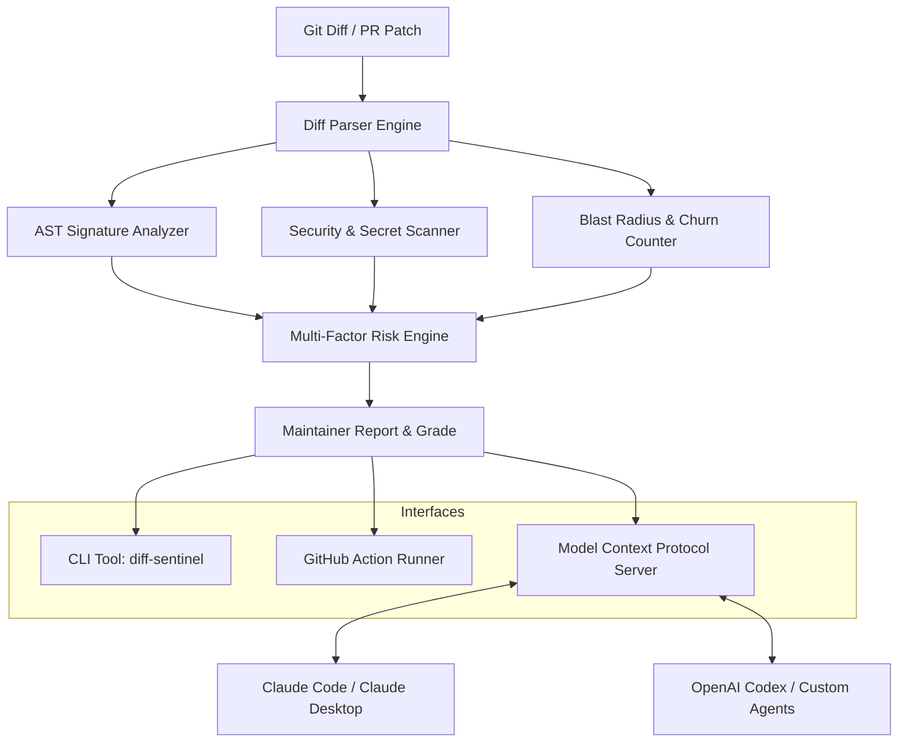

<div align="center">

# 🛡️ diff-sentinel

**Autonomous Open-Source Maintainer Sentinel & Model Context Protocol (MCP) Server**

*Lightweight AST & Unified Git Diff Analyzer, Security Secret Scanner, Breaking Change Detector, GitHub Action, and AI Maintainer Companion.*

[](https://github.com/your-username/diff-sentinel/actions)
[](LICENSE)
[](https://modelcontextprotocol.io)
[](package.json)
[](CONTRIBUTING.md)

</div>

---

## ⚡ Overview

Maintaining high-velocity open-source repositories is exhausting:
- PR reviews accumulate faster than maintainers can review them.
- Leaked credentials, API tokens, and dangerous runtime patterns slip through manual reviews.
- Subtle breaking API changes (e.g. modified function signatures, removed public exports) break downstream packages.
- PRs modify complex production logic without updating test coverage.

**diff-sentinel** is built from the ground up for open-source maintainers and AI coding agents (such as **Claude Code**, **OpenAI Codex**, and **Cursor**). It provides deep, sub-millisecond AST-level patch inspection, automated risk scoring (0–100), security vulnerability detection, issue triage, and an official **Model Context Protocol (MCP)** server interface.

---

## 🌟 Key Features

- **🚀 Sub-Millisecond Unified Diff Parsing**: Accurately parses hunk headers, added/deleted lines, renames, and calculates blast radius across codebases.
- **🔍 AST-Level Breaking Change Detection**: Identifies removed public exports, altered parameter signatures, and type narrowing across TypeScript, JavaScript, Python, and Go.
- **🔐 Deep Secret & Vulnerability Scanner**: Intercepts OpenAI keys, Anthropic keys, AWS IAM tokens, GitHub PATs, private cryptographic keys, and unsafe APIs (`eval`, shell injection, SQL concatenation).
- **🎯 Multi-Factor PR Risk Engine**: Generates a composite risk score (0 to 100), letter grade (A through F), and determines `isSafeToMerge` based on churn, sensitive path impact, and test coverage gaps.
- **🤖 Model Context Protocol (MCP) Server**: Native stdio JSON-RPC 2.0 server allowing AI assistants (Claude Desktop, Claude Code, OpenAI agents) to audit diffs, scan secrets, and triage issues directly.
- **📋 Automated Issue Triager**: Classifies incoming GitHub issues into categories (`bug`, `feature`, `security`, `documentation`), checks for minimal reproduction steps, and suggests triage labels.
- **📦 Semantic Changelog Generator**: Parses Conventional Commits and automatically suggests SemVer version bumps (`major`, `minor`, `patch`) formatted in Keep-a-Changelog Markdown.
- **⚙️ GitHub Action Ready**: Drop-in composite action (`action.yml`) to guard PRs directly in CI/CD pipelines.

---

## 📐 Architecture



---

## 🚀 Quick Start

### 1. Run via CLI

```bash
# Analyze git diff from latest commit
git diff HEAD~1 | diff-sentinel diff

# Run strict audit (fails CI if high risk or secrets are found)
git diff HEAD~1 | diff-sentinel diff --strict

# Output machine-readable JSON for automated pipelines
diff-sentinel diff pr.patch --json
```

### 2. Triage an Issue

```bash
diff-sentinel triage "Crash on startup when parsing malformed diff" issue_body.md
```

### 3. Generate Semantic Release Changelog

```bash
git log -n 20 --oneline | diff-sentinel changelog 1.2.0
```

### 4. Audit Repository Hygiene

```bash
diff-sentinel audit .
```

---

## 🤖 Model Context Protocol (MCP) Integration

`diff-sentinel` ships with a native Model Context Protocol server. This allows AI assistants like **Claude Code**, **Claude Desktop**, and **Cursor** to execute repository audits and diff reviews autonomously.

### Configure Claude Desktop (`claude_desktop_config.json`)

On macOS: `~/Library/Application Support/Claude/claude_desktop_config.json`  
On Windows: `%APPDATA%\Claude\claude_desktop_config.json`

```json
{
  "mcpServers": {
    "diff-sentinel": {
      "command": "node",
      "args": [
        "--experimental-strip-types",
        "/absolute/path/to/diff-sentinel/src/cli.ts",
        "mcp"
      ]
    }
  }
}
```

### Available MCP Tools

| Tool | Description |
| ---- | ----------- |
| `analyze_diff` | Full AST-aware diff audit: security findings, breaking changes, churn, risk score. |
| `scan_security` | Rapid scan for leaked credentials (OpenAI, Anthropic, GCP, AWS, GitHub) & unsafe APIs. |
| `analyze_complexity` | Evaluates cognitive & cyclomatic complexity and pinpoints nested hotspots. |
| `analyze_dependencies` | Detects package downgrades, loosened pins, and typosquatting risks. |
| `format_pr_comment` | Generates a publication-ready GitHub Markdown comment with tables and checklists. |
| `triage_issue` | Classifies GitHub issues, estimates complexity, checks for reproduction steps. |
| `generate_changelog` | Formats conventional commits and calculates recommended SemVer bumps. |
| `audit_repository` | Evaluates open-source community standards (licenses, CI, security policy). |

---

## 🐙 GitHub Action Setup

Add `diff-sentinel` directly into your GitHub repository to gate every pull request:

Create `.github/workflows/sentinel-review.yml`:

```yaml
name: Pull Request Sentinel Audit

on:
  pull_request:
    branches: [main, master]

jobs:
  audit:
    runs-on: ubuntu-latest
    steps:
      - name: Checkout Code
        uses: actions/checkout@v4
        with:
          fetch-depth: 0

      - name: Run diff-sentinel
        uses: your-username/diff-sentinel@v1
        with:
          base-ref: ${{ github.base_ref }}
          strict: true
```

---

## 🧪 Testing

`diff-sentinel` contains a 100% native test suite running via Node's built-in test runner without any external runtime dependencies:

```bash
npm test
```

---

## 🤝 Contributing

We love contributions! Please read our [Contributing Guide](CONTRIBUTING.md) and review our [Code of Conduct](CODE_OF_CONDUCT.md).

## 📄 License

Licensed under the **Apache License, Version 2.0**. See [LICENSE](LICENSE) for details.
