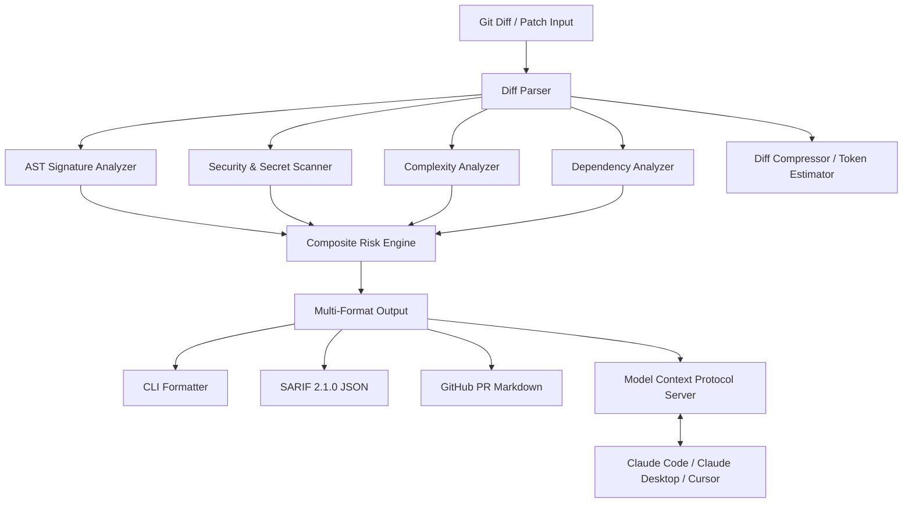

<div align="center">

# diff-sentinel

**Fast AST git diff analyzer, secret detector, SARIF exporter, and Model Context Protocol (MCP) server for automated code reviews.**

[](https://github.com/TonyStarkgenetic/diff-sentinel-ai/actions)
[](LICENSE)
[](https://modelcontextprotocol.io)
[](package.json)
[](tests)

</div>

---

## Overview

Reviewing pull requests at scale is challenging:
- Leaked credentials, cloud tokens, and dangerous runtime patterns can slip past human reviewers.
- Subtle public API signature changes cause silent downstream breaking changes.
- Large diffs containing lockfiles, vendor bundles, and minified assets waste LLM context window tokens.
- Critical logic modifications are frequently submitted without accompanying test coverage.

`diff-sentinel` is a zero-dependency static analysis tool and Model Context Protocol (MCP) server designed for developers, CI/CD pipelines, and coding agents (Claude Code, Cursor, Codex). It provides sub-millisecond patch parsing, AST breaking change detection, secret scanning, supply-chain checks, and prompt token compression.

---

## Key Features

- **Unified Diff Parser**: Parses hunks, additions, deletions, and file renames with blast-radius calculation.
- **AST Breaking Change Detection**: Identifies removed exports and modified parameter signatures across TypeScript, JavaScript, Python, Go, and Rust, while distinguishing optional/default parameters.
- **Secret & Vulnerability Scanner**: 22 built-in rules detecting OpenAI, Anthropic, AWS, GCP, GitHub, Discord, database URLs, JWTs, and unsafe dynamic execution (`eval`, shell injection, SQL concat).
- **SARIF 2.1.0 Export**: Full compatibility with GitHub Advanced Security and Code Scanning tabs.
- **LLM Context Optimizer**: Compresses diffs by filtering lockfile/asset noise, reducing prompt tokens by 60–80%.
- **Model Context Protocol (MCP)**: Native JSON-RPC 2.0 stdio server providing 10 tools for Claude Desktop, Claude Code, and Cursor.
- **Cognitive Complexity Analyzer**: Detects deeply nested conditional logic and flags maintainability hotspots.
- **Supply-Chain Dependency Guard**: Analyzes manifest diffs (`package.json`, `requirements.txt`, `Cargo.toml`) for package downgrades, loosened pins, and typosquatting risks.
- **Automated Issue Triage**: Classifies issues by category, urgency, reproduction completeness, and labels.
- **Zero Runtime Dependencies**: Runs natively using Node.js 22+ type-stripping and built-in test runner.

---

## Architecture



---

## Quick Start

### Installation

Run directly with Node.js 22+ without prior installation:

```bash
# Run via npx or global runner
npx diff-sentinel --help
```

Or clone the repository:

```bash
git clone https://github.com/TonyStarkgenetic/diff-sentinel-ai.git
cd diff-sentinel-ai
npm test
```

### CLI Commands

#### 1. Analyze Pull Request Diff

```bash
# Audit latest commit
git diff HEAD~1 | node --experimental-strip-types src/cli.ts diff

# Strict mode: exits with code 1 on critical security findings or high risk
git diff origin/main...HEAD | node --experimental-strip-types src/cli.ts diff --strict
```

#### 2. Compress Diff for LLM Prompts (Save 60-80% Tokens)

```bash
# Strips lockfiles and generated assets, outputting compact prompt-ready text
git diff origin/main...HEAD | node --experimental-strip-types src/cli.ts pack
```

#### 3. Export to SARIF for GitHub Code Scanning

```bash
git diff origin/main...HEAD | node --experimental-strip-types src/cli.ts diff --sarif > results.sarif
```

#### 4. Audit Dependencies and Supply Chain

```bash
git diff origin/main...HEAD | node --experimental-strip-types src/cli.ts deps
```

#### 5. Analyze Cognitive Complexity

```bash
git diff origin/main...HEAD | node --experimental-strip-types src/cli.ts complexity
```

#### 6. Generate Conventional Commit Changelog

```bash
git log -n 15 --oneline | node --experimental-strip-types src/cli.ts changelog 1.3.0
```

---

## Model Context Protocol (MCP) Integration

`diff-sentinel` implements the Model Context Protocol (spec 2024-11-05) over stdio.

### Configuration for Claude Desktop

Add the following to your `claude_desktop_config.json`:

- macOS: `~/Library/Application Support/Claude/claude_desktop_config.json`
- Windows: `%APPDATA%\Claude\claude_desktop_config.json`

```json
{
  "mcpServers": {
    "diff-sentinel": {
      "command": "node",
      "args": [
        "--experimental-strip-types",
        "/absolute/path/to/diff-sentinel-ai/src/cli.ts",
        "mcp"
      ]
    }
  }
}
```

### Configuration for Claude Code

In your project repository, run:

```bash
claude mcp add diff-sentinel -- node --experimental-strip-types /absolute/path/to/diff-sentinel-ai/src/cli.ts mcp
```

### Available MCP Tools

| Tool | Description |
| :--- | :--- |
| `analyze_diff` | Full AST-aware diff audit: security findings, breaking changes, churn, risk score. |
| `scan_security` | Rapid scan for exposed credentials (OpenAI, Anthropic, GCP, AWS, GitHub) and unsafe APIs. |
| `export_sarif` | Generates official SARIF 2.1.0 output for GitHub Advanced Security ingestion. |
| `pack_diff_for_llm` | Compresses git patches by omitting lockfile noise and reports token savings. |
| `analyze_complexity` | Evaluates cognitive and cyclomatic complexity; pinpoints nested hotspots. |
| `analyze_dependencies` | Detects package downgrades, loosened pins, and typosquatting risks. |
| `format_pr_comment` | Generates a publication-ready GitHub Markdown comment with tables and checklists. |
| `triage_issue` | Classifies GitHub issues, checks reproduction completeness, suggests labels. |
| `generate_changelog` | Parses conventional commits and calculates recommended SemVer bump. |
| `audit_repository` | Evaluates repository hygiene against open-source community standards. |

---

## GitHub Actions Integration

### Automated PR Review & SARIF Upload

Create `.github/workflows/sentinel.yml`:

```yaml
name: diff-sentinel Audit

on:
  pull_request:
    branches: [main, master]

permissions:
  contents: read
  pull-requests: write
  security-events: write

jobs:
  review:
    runs-on: ubuntu-latest
    steps:
      - name: Checkout
        uses: actions/checkout@v4
        with:
          fetch-depth: 0

      - name: Setup Node.js
        uses: actions/setup-node@v4
        with:
          node-version: '22'

      - name: Generate Diff
        run: |
          git fetch origin ${{ github.base_ref }} --depth=1
          git diff origin/${{ github.base_ref }}...HEAD > pr.diff

      - name: Run SARIF Export
        run: |
          node --experimental-strip-types src/cli.ts diff pr.diff --sarif > sentinel-results.sarif

      - name: Upload SARIF to GitHub Code Scanning
        uses: github/codeql-action/upload-sarif@v3
        if: always()
        with:
          sarif_file: sentinel-results.sarif
```

---

## Configuration

`diff-sentinel` can be configured via a `.sentinelrc.json` file in the root of your repository:

```json
{
  "ignorePatterns": [
    "**/node_modules/**",
    "**/dist/**",
    "**/*.min.js",
    "**/coverage/**"
  ],
  "strictMode": false,
  "riskThreshold": 50,
  "maxAllowedComplexity": 35,
  "disableRuleIds": []
}
```

---

## Testing

The test suite runs with Node's built-in test runner without third-party frameworks:

```bash
npm test
```

Current test coverage: **34 tests across 14 test suites (100% pass rate)**.

---

## License

Apache License, Version 2.0. See [LICENSE](LICENSE) for details.
